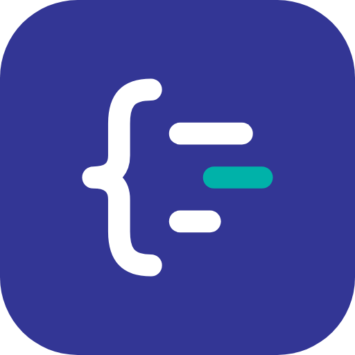

# Prettier Plugin for ObjectScript



An opinionated [Prettier 3](https://prettier.io/) plugin for InterSystems ObjectScript class files (`.cls`). Parsing is provided by the UDL grammar from [`tree-sitter-objectscript`](https://github.com/intersystems/tree-sitter-objectscript).

To get started, check the [requirements](#requirements) and follow the [installation](#installation) steps.

## Example

Input (`example.cls`):

```text
Class Demo.Greeter Extends %RegisteredObject {
Property Name As %String [Required];

/// Returns a greeting for the given name.
ClassMethod Greet(name As %String="world",times As %Integer=1) As %String [ Private ]
{
 s result=""
 f i=1:1:times {
 s result=result_"Hello, "_name_"! "
 }
 q:name="" "nobody"
 i times>1 { w "Greeted ",times," times",! }
 q result
}
}
```

Output of `npx prettier --plugin ./index.js example.cls`:

```objectscript
Class Demo.Greeter Extends %RegisteredObject
{
  Property Name As %String [Required];

  /// Returns a greeting for the given name.
  ClassMethod Greet(
    name As %String = "world",
    times As %Integer = 1
  ) As %String [Private]
  {
    Set result = ""
    For i = 1:1:times {
      Set result = result_"Hello, "_name_"! "
    }
    Quit:name="" "nobody"
    If times > 1 {
      Write "Greeted ", times, " times", !
    }
    Quit result
  }
}
```

Abbreviated commands are expanded, braces and indentation are normalized, and binary operators get spaces. Concatenation (`_`) and postconditionals (`Quit:name=""`) stay compact because a space would change their meaning.

## Features

- canonical command casing and optional abbreviation expansion (`s` → `Set`);
- indentation for classes, methods, blocks, commands and JSON literals;
- spaces around binary operators and after commas in arguments;
- formatting for ObjectScript expressions, arguments, types and object references;
- configurable brace position for class and member declarations (`next-line` by default);
- optional strict parsing;
- regression tests that check the expected output, valid output syntax, idempotence and, with Docker, the behavior in InterSystems IRIS.

## Requirements

- Node.js 22 or newer;
- npm;
- Git (npm uses it to install the plugin from GitHub);
- Prettier 3 (installed locally by the commands below).

The ObjectScript parser, [`tree-sitter-objectscript`](https://www.npmjs.com/package/tree-sitter-objectscript), is installed automatically with prebuilt binaries for Windows, macOS and Linux (x64 and arm64), so no compiler is needed on those systems. It takes about 400 MB of disk space because it bundles the binaries of all platforms.

The prebuilt binaries need Node.js 22 or newer. With Node.js 18 or 20 the prebuilt `tree-sitter` runtime crashes when it is loaded (observed on Windows), so npm compiles it from source instead, which requires the toolchain below.

On other platforms (for example Linux with musl, such as Alpine), npm compiles the parser with [`node-gyp`](https://github.com/nodejs/node-gyp#installation), which requires a C/C++ build toolchain and Python 3:

- Windows: [Visual Studio Build Tools](https://visualstudio.microsoft.com/visual-cpp-build-tools/) with the "Desktop development with C++" workload;
- macOS: Xcode Command Line Tools (`xcode-select --install`);
- Linux: `make`, `g++` and `python3` (for example the `build-essential` package on Debian/Ubuntu).

If `npm install` fails with a `gyp ERR!` message, the toolchain is missing or not detected. Python 3.12 or newer requires `node-gyp` 10 or later, which is included in npm 10 and newer.

## Installation

1. Open a terminal in the root of your project. If the project does not have a `package.json` yet, create one:

   ```bash
   npm init -y
   ```

2. Install the workspace-local copy of Prettier and this plugin:

   ```bash
   npm install --save-dev prettier git+https://github.com/FilippoGalli001/prettier-plugin-objectscript.git#v2.0.3
   ```

   The plugin is installed from GitHub. The `#v2.0.3` suffix selects a [tag](https://github.com/FilippoGalli001/prettier-plugin-objectscript/tags); without it, npm installs the latest commit of `main`. To upgrade, run the same command with the newer tag.

3. Create `.prettierrc` in the project root:

   ```json
   {
     "plugins": ["prettier-plugin-objectscript"],
     "tabWidth": 2,
     "printWidth": 100,
     "objectScriptCommandCase": "title",
     "objectScriptExpandCommands": true,
     "objectScriptStrictParsing": false
   }
   ```

4. Preview the formatted result without changing the file:

   ```bash
   npx prettier path/to/MyClass.cls
   ```

5. Format one file in place:

   ```bash
   npx prettier --write path/to/MyClass.cls
   ```

6. Format or check all `.cls` files:

   ```bash
   npx prettier --write "src/**/*.cls"
   npx prettier --check "src/**/*.cls"
   ```

A file is considered stable when formatting it a second time produces no further changes. The test suite verifies this idempotence for every fixture.

To work on the plugin itself, see [CONTRIBUTING.md](CONTRIBUTING.md).

## Enforcing the style with Git

Commit `package.json`, `package-lock.json` and `.prettierrc`, so that everyone formats with the same plugin version and options. Files that must not be formatted, such as generated classes, go in a `.prettierignore` file in the project root, one glob per line:

```text
src/Generated/**
```

**In CI.** This GitHub Actions workflow (`.github/workflows/format.yml`) fails when a committed `.cls` file is not formatted:

```yaml
name: Format
on: [push, pull_request]
jobs:
  prettier:
    runs-on: ubuntu-latest
    steps:
      - uses: actions/checkout@v4
      - uses: actions/setup-node@v4
        with:
          node-version: 22
      - run: npm ci
      - run: npx prettier --check "**/*.cls"
```

**Before each commit.** [husky](https://typicode.github.io/husky/) and [lint-staged](https://github.com/lint-staged/lint-staged) format the staged `.cls` files when you run `git commit`:

```bash
npm install --save-dev husky lint-staged
npx husky init
```

Replace the content of `.husky/pre-commit` with `npx lint-staged` and add to `package.json`:

```json
{
  "lint-staged": {
    "*.cls": "prettier --write"
  }
}
```

## Configuration

Options are set in `.prettierrc` or passed on the command line (for example `--object-script-brace-style=same-line`).

| Option                             | Default     | Description                                                                                                               |
| ---------------------------------- | ----------- | ------------------------------------------------------------------------------------------------------------------------- |
| `objectScriptCommandCase`          | `title`     | `title`, `uppercase` or `lowercase` command casing.                                                                       |
| `objectScriptExpandCommands`       | `true`      | Expands command abbreviations.                                                                                            |
| `objectScriptBraceStyle`           | `next-line` | `next-line` or `same-line`: position of the opening brace of classes, methods, `XData`, `Storage`, `Query` and `Trigger`. |
| `objectScriptBreakLongExpressions` | `false`     | Breaks parenthesized expressions longer than `printWidth` after their binary operators. Experimental: see Limitations.    |
| `objectScriptStrictParsing`        | `false`     | Throws when Tree-sitter reports `ERROR` or missing nodes.                                                                 |

Strict parsing is opt-in because the upstream grammar can still report an error for some valid legacy ObjectScript constructs (the pinned version no longer does for `ClientMethod`, macros used as statements, `Property` arguments or `Index ... On` with `ELEMENTS`/`KEYS`). The test suite separately guarantees that every generated fixture parses without errors.

The debugging options (`objectScriptDebug*`) are described in [CONTRIBUTING.md](CONTRIBUTING.md#selective-debugging).

## Formatting rules

- **Braces:** the opening brace of classes, methods, `XData`, `Storage`, `Query` and `Trigger` goes on its own line (`next-line`, as in the InterSystems documentation) or stays on the same line with `objectScriptBraceStyle: "same-line"`. Control-flow blocks (`If`, `For`, `Try`, ...) always keep the brace on the same line.
- **Operators:** binary operators are surrounded by spaces (`a*b+c` becomes `a * b + c`) and arguments get a space after each comma, including in subscripts (`^Data(x + 1, "a")`).
- **Kept compact:** concatenation (`_`), pattern matches, `For` ranges, timeouts and postconditionals (`Quit:x=1`), because a space would change their meaning or end them. A fully parenthesized postconditional, `Quit:(x = 1)`, is spaced normally.
- **One line:** a legacy `If`, `Else` or `For` without braces keeps the commands that follow it on its line, because its scope ends with the line, and a postconditional is never broken across lines.
- **Kept as written:** the arguments of macro calls (`$$$ERROR($$$GeneralError,"x")`) and the conditions and macro definitions of preprocessor directives (`#If`, `#Define`), because macros are expanded as text, and the bodies of `XData`, `Storage`, `Query` and of triggers and methods written in another language (SQL, Python, ...). Their headers and keywords are still formatted.
- **Line width:** a method signature that exceeds `printWidth` puts one parameter per line. The example above is formatted with the default width of 80; with `printWidth: 100` the `Greet` signature fits on one line.

## Limitations

- Only class definition files (`.cls`, UDL format) are supported. Routines and include files (`.mac`, `.int`, `.inc`) are not.
- Regions that Tree-sitter cannot parse are left exactly as written instead of being formatted. Enable `objectScriptStrictParsing` to turn them into errors, or use `npm run inspect:ast` to locate them.
- Subscripts are never broken across lines, and long lines are wrapped only at the commas of function arguments. `objectScriptBreakLongExpressions` also breaks parenthesized expressions after their operators, but it is disabled by default because the InterSystems documentation does not state the rule for operators: check the result with the compiler before enabling it.

## Editor integration

The plugin works with the Prettier extension of VS Code. Once the plugin is installed and `.prettierrc` is configured, this `.vscode/settings.json` formats `.cls` files on save:

```json
{
  "[objectscript-class]": {
    "editor.defaultFormatter": "esbenp.prettier-vscode",
    "editor.formatOnSave": true
  },
  "prettier.requireConfig": true
}
```

The full setup and troubleshooting are in [docs/vscode.md](docs/vscode.md).

## License

MIT
